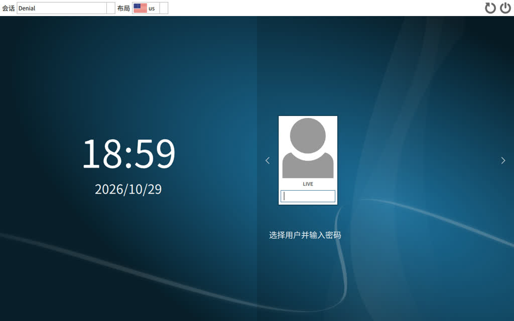

# Arch + Denial 救援 Live

> 以 **Arch Linux** 为底、**[Denial](https://github.com/denialwm/denial)** Wayland 桌面为界面的可启动救援系统镜像。
> 默认中文环境 + **fcitx5 拼音输入法**，内置 **opencode AI 助手**，专治 **Windows 引导损坏（C 盘进不去）** 与 **Linux 系统无法启动**，支持**离线整盘安装**与在线补装任意桌面。




## 下载

发行版下载页（Releases）：

- `ARCH-DENIAL-RESCUE-*.iso`（约 1.4 GB，UEFI + Legacy BIOS 双启动）

写盘：

```bash
# 方法一：dd 直写 U 盘
sudo dd if=ARCH-DENIAL-RESCUE-*.iso of=/dev/sdX bs=4M status=progress oflag=sync

# 方法二：Ventoy（推荐）—— 装好 Ventoy 后把 ISO 拷进 U 盘即可
```

## 登录

| 用户 | 密码 | 说明 |
|---|---|---|
| `live` | 空 | 开机自动登录进 Denial 桌面，免密 sudo |
| `root` | 空 | tty2 / 串口控制台自动登录 |

远程救援：`sudo passwd root` 设密码后 `ssh root@<IP>`（或串口直连，已开 `console=ttyS0,115200`）。

## 核心功能

### 修 Windows 引导（C 盘进不去 / 蓝屏 0xc000000f / 找不到启动设备）

```bash
sudo fixboot win              # UEFI：从 NTFS 分区回拷 bootmgfw.efi/BCD 到 ESP，重建 UEFI 启动项
sudo fixboot win-mbr /dev/sda # Legacy：重写 MBR 引导代码并激活 NTFS 分区
```

配套：`chntpw`（清 Win 本地账户密码）、`wimlib-imagex`（读写 WIM/BCD）、`ntfs-3g`。

### 修 Linux 引导（grub 坏了 / initramfs 挂了 / 内核起不来）

```bash
sudo fixboot linux            # 自动扫描 Arch 系根分区 → chroot → 重装内核 + mkinitcpio + grub/systemd-boot
sudo fixboot linux /dev/sda2  # 手动指定根分区
```

### 安装系统

```bash
sudo install-live /dev/sda    # ★ 离线整盘安装：把 live 系统原样复制进硬盘（自动 GPT 分区/引导/fstab），全程不需要网络
archinstall                   # 官方引导式在线安装器
live-de gnome|kde|xfce|mate|lxqt|cinnamon|hyprland|sway|i3   # 在线补装其他桌面
```

### AI 救援助手

```bash
sudo -i opencode
```

- [opencode](https://opencode.ai)（Arch 官方仓库包）：`/auth` 选 **OpenCode Zen** 免费模型额度，无需 API key；也支持 GitHub Copilot 免费额度
- 可选（在线安装）：`gemini-cli`（Google 个人账号免费额度）、`qwen-code`（通义免费额度）
- 纯离线场景：AI 无法推理（模型在云端），但内置的 fixboot/install-live/testdisk/ddrescue 等全部离线可用；也可手机 **USB 共享网络**秒级联网后继续用 AI

### 桌面与中文

- **Denial 0.5.1**：Flutter 原生 Wayland 合成器，玻璃特效 + 三种窗口布局，自带分组启动器（不装第三方）
- 默认语言 `zh_CN.UTF-8`，时区 Asia/Shanghai
- **fcitx5 + rime 拼音**，`Ctrl` 切换中英文，登录自动启动
- 思源黑体 + 文泉驿微米黑 + terminus 终端字体

### 内置救援工具

分区/磁盘：`gparted 级 parted/gptfdisk/fatresize/gpart` `testdisk/photorec` `ddrescue` `fsarchiver` `smartmontools` `nvme-cli` `hdparm` `lvm2` `mdadm` `cryptsetup`
文件系统：ext4/btrfs/xfs/jfs/f2fs/ntfs/exfat/fat 全套读写工具
网络：NetworkManager + iwd + dhcpcd 备选 + openssh
引导：grub / systemd-boot / refind / efibootmgr / os-prober / memtest86+
硬件：常见 Intel/AMD/Realtek/Broadcom/MediaTek/Atheros 固件 + CPU 微码

## 持续集成（自动跟随上游更新）

仓库内置 GitHub Actions 工作流（`.github/workflows/build-iso.yml`）：

- **每小时**在云端拉取 Arch 官方仓库最新包版本，与 `packages.lock` 比对
- **有更新才构建**（opencode 免费额度依赖新版客户端、denial 频繁发版，全部自动跟进）
- 构建产物自动发布到 Release：`rolling`（最新版，直接下载用）+ 每日归档 `rolling-YYYY.MM.DD`（保留最近 5 份）
- 修改 `profile/` 或 `scripts/` 推上来也会触发一次完整构建
- 也可在 Actions 页面手动触发（支持"强制构建"）

也就是说：你只需要维护 `profile/packages.x86_64`（想装/删什么软件），ISO 由云端自动保持新鲜。

## 从源码构建

```bash
# 依赖：Arch Linux（宿主 root + archiso），或跑 docker-builder.sh 造免 root 构建容器
git clone https://github.com/Duckyal/arch-denial-live && cd arch-denial-live
sudo pacman -Sy                       # 刷新本地同步库（deps.py 解析闭包用）
bash scripts/build-iso.sh             # 解析闭包→下载→本地仓库→mkarchiso
# 产物在 out/*.iso
```

构建脚本链：`deps.py`（闭包解析）→ `fetch-packages.sh`（24 路并发 + 多镜像回退）→ `make-repo.sh`（离线仓库）→ `build-iso.sh`（mkarchiso）。
`profile/` 即 archiso 配置：`packages.x86_64` 软件清单、`airootfs/etc` 系统定制、`airootfs/usr/local/bin` 救援脚本（fixboot / install-live / live-de）。

## 体积取舍（1.4 GB 的由来）

刻意保持最小：不内置软件包仓库（离线安装走 squashfs 整盘复制）；输入法用 rime 避开 `fcitx5-chinese-addons → qt6-webengine`（省 185MB）；不装 noto-cjk 全家桶（denial 自带思源黑体依赖，省 300MB）；不带 NVIDIA 专有固件（106MB，救援走开源驱动）；删除 man 多余语言/gir/include/doc（省 ~300MB）。

## 许可

- 本仓库构建配置与脚本：GPL-3.0
- Denial 桌面：GPL-3.0-or-later / CC-BY-SA-4.0（见上游）
- 壁纸：请自行放入 `profile/airootfs/usr/share/backgrounds/arch-denial/default.jpg`（受版权保护，不随仓库分发；缺省自动生成占位渐变图）
